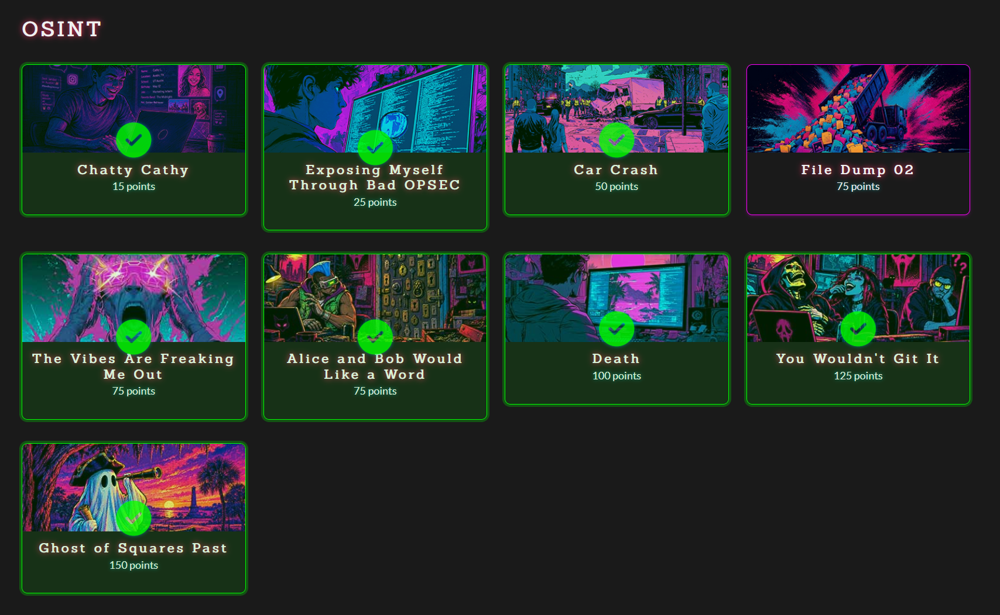

# The entire OSINT category

Overall Difficulty: ★★★★★☆☆☆☆☆  &emsp;&emsp;&emsp;&emsp;&emsp;&emsp; Solved by: youstube_

## challenge according to points

This is my first CTF played with AFNOM, the CTF team in UoB. So I figured it deserved a bit of a writeup :P  
I solved basically the entire OSINT category, with one having a teammate to submit for me :trollface:  
I hope I won't take too long writing all these :skull: Anyways enjoy!!
  
|   Challenges   |                    Write-up                   |
| -------------- | :-------------------------------------------: |
| Chatty Cathy | **[Click here](chatty cathy/README.md)**  |
| Exposing Myself Through Bad OPSEC | **[Click here](Exposing Myself Through Bad OPSEC/README.md)**  |
| Car Crash | **[Click here](Car Crash/README.md)**  |
| File Dump 2 | **[Click here](File Dump 2/README.md)**  |
| The Vibes Are Freaking Me Out | **[Click here](The Vibes Are Freaking Me Out/README.md)**  |
| Alice and Bob Would Like a Word | **[Click here](Alice and Bob Would Like a Word/README.md)**  |
| Death | **[Click here](Death/README.md)**  |
| You Wouldn't Git It | **[Click here](You Wouldn't Git It/README.md)**  |
| Ghost of Squares Past | **[Click here](Ghost of Squares Past/README.md)**  |
