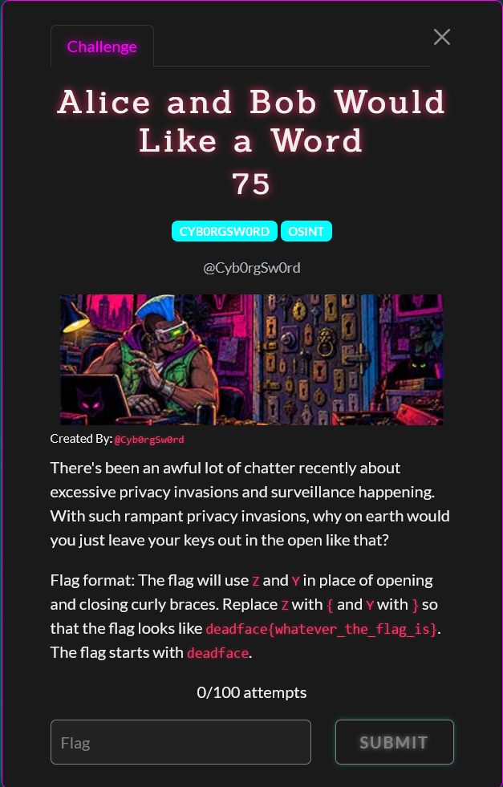

# Alice and Bob Would Like A Word

Difficulty: ★★★★☆☆☆☆☆☆ &emsp;&emsp;&emsp;&emsp;&emsp;&emsp;&emsp;&emsp; Solved by youstube
  

## Details

- Author: RP-01?
- Category: OSINT
- Score: 50

## Description

> There's been an awful lot of chatter recently about excessive privacy invasions and surveillance happening. With such rampant privacy invasions, why on earth would you just leave your keys out in the open like that?
> 
> Flag format: The flag will use Z and Y in place of opening and closing curly braces. Replace Z with { and Y with } so that the flag looks like deadface{whatever_the_flag_is}. The flag starts with deadface.

## Write up

WIP

## My understanding

WIP

## My Solution

WIP

## Conclusion

WIP

## Shoutout

- WIP

 

 Tags: WIP

