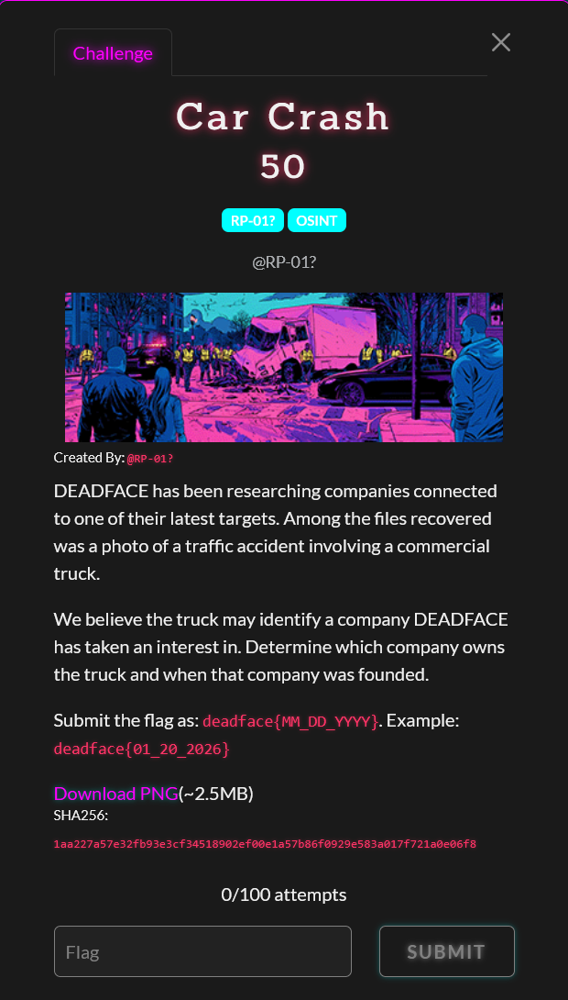

# Car Crash

Difficulty: ★☆☆☆☆☆☆☆☆☆ &emsp;&emsp;&emsp;&emsp;&emsp;&emsp;&emsp;&emsp; Solved by youstube
  

## Details

- Author: RP-01?
- Category: OSINT
- Score: 50

## Description

> DEADFACE has been researching companies connected to one of their latest targets. Among the files recovered was a photo of a traffic accident involving a commercial truck.
> 
> We believe the truck may identify a company DEADFACE has taken an interest in. Determine which company owns the truck and when that company was founded.
> 
> Submit the flag as: deadface{MM_DD_YYYY}. Example: deadface{01_20_2026}

## Write up

WIP

## My understanding

WIP

## My Solution

WIP

## Conclusion

WIP

## Shoutout

- WIP

 

 Tags: WIP

