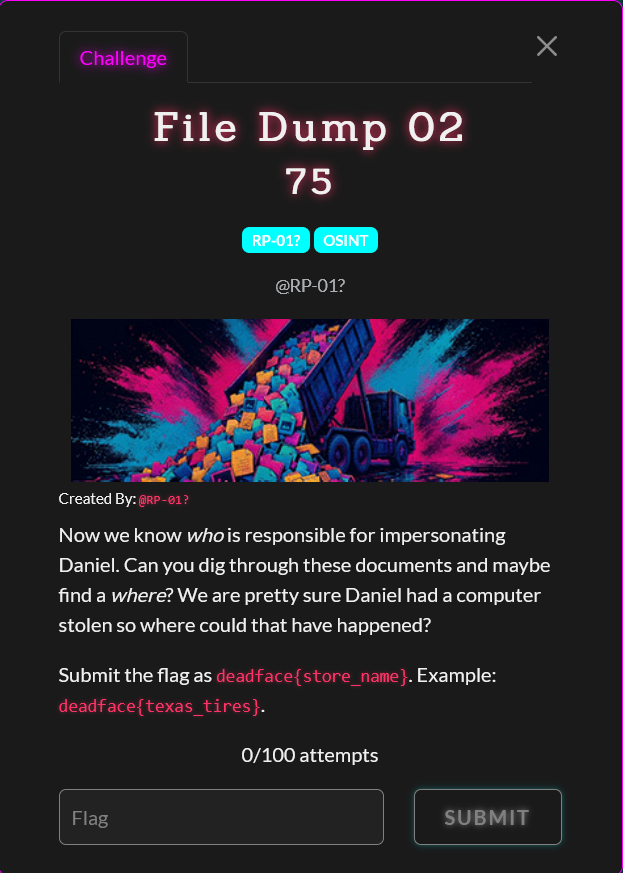

# File Dump 2

Difficulty: ★★★★★★☆☆☆☆ &emsp;&emsp;&emsp;&emsp;&emsp;&emsp;&emsp;&emsp; didnt solve
  

## Details

- Author: RP-01?
- Category: OSINT
- Score: 75

## Description

> Now we know who is responsible for impersonating Daniel. Can you dig through these documents and maybe find a where? We are pretty sure Daniel had a computer stolen so where could that have happened?
> 
> Submit the flag as deadface{store_name}. Example: deadface{texas_tires}.

## Write up

WIP

## My understanding

WIP

## My Solution

WIP

## Conclusion

WIP

## Shoutout

- WIP

 

 Tags: WIP

