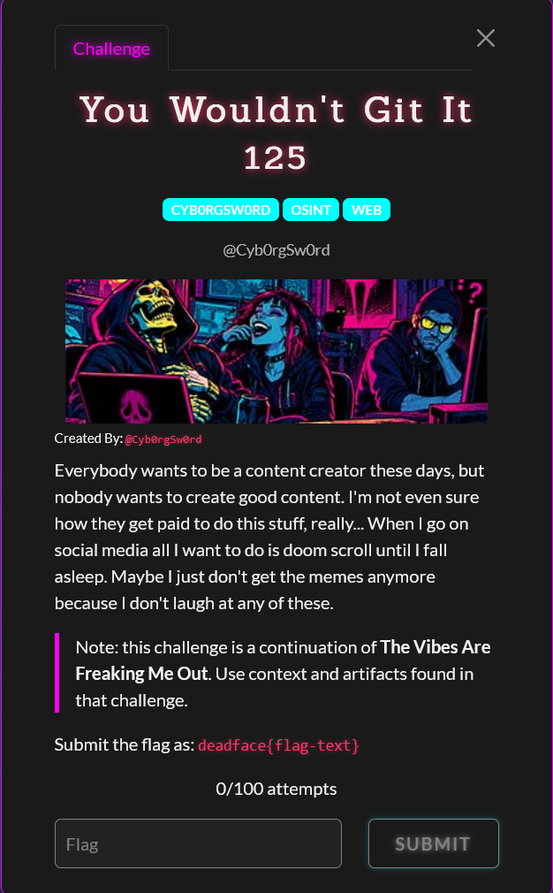

# You Wouldn't Git It

Difficulty: ★★★★★★☆☆☆☆ &emsp;&emsp;&emsp;&emsp;&emsp;&emsp;&emsp;&emsp; Solved by youstube
  

## Details

- Author: Cyb0rgSw0rd
- Category: OSINT
- Score: 125

## Description

> Everybody wants to be a content creator these days, but nobody wants to create good content. I'm not even sure how they get paid to do this stuff, really... When I go on social media all I want to do is doom scroll until I fall asleep. Maybe I just don't get the memes anymore because I don't laugh at any of these.
> 
>     Note: this challenge is a continuation of The Vibes Are Freaking Me Out. Use context and artifacts found in that challenge.
> 
> Submit the flag as: deadface{flag-text}

## Write up

WIP

## My understanding

WIP

## My Solution

WIP

## Conclusion

WIP

## Shoutout

- WIP

 

 Tags: WIP

